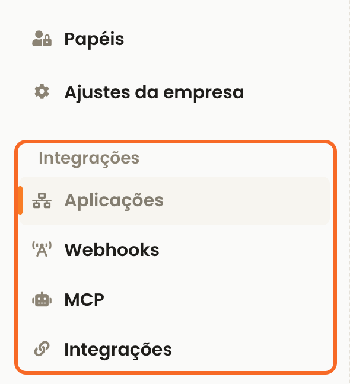
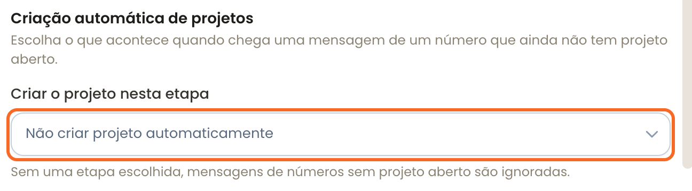

Esta página mostra os caminhos para trocar informação entre a Olie e outros sistemas: trazer dados de fora ou avisar alguém lá fora. Ela serve a quem administra a conta e configura os canais, e a quem desenvolve integrações pela API.

## Onde fica

No menu de **Ajustes**, o grupo **Integrações** tem dois itens: **Integrações** e **API**. A tela **API** reúne as abas **Aplicações**, **Webhooks** e **MCP**.

<Frame caption="O grupo Integrações no menu de Ajustes">
  
</Frame>

<CardGroup cols={2}>
<Card title="Integrações" icon="plug">
  As contas conectadas — hoje, canais de comunicação.
</Card>

<Card title="Aplicações" icon="key">
  Os tokens de acesso à [API](/api-reference/introduction).
</Card>

<Card title="MCP" icon="robot" href="/guides/mcp/overview">
  A conexão com ChatGPT e Claude.
</Card>

<Card title="Webhooks" icon="bell" href="/guides/integrations/event-webhooks">
  Avisos assinados quando projetos, clientes e contatos mudam.
</Card>
</CardGroup>

<Note>
Ver e configurar integrações depende das permissões do grupo **Integrações** no [papel](/guides/users/roles-permissions): visualizar, criar, editar e remover integrações. Por padrão, só o papel Property recebe essas permissões. Para os demais papéis, marque-as na configuração do papel.
</Note>

## Canais de comunicação

Uma integração de comunicação conecta um número ou uma conta externa à plataforma. A partir daí, a conversa acontece **dentro do projeto**, em um canal — e fica registrada na empresa, não no celular de quem atendeu.

### Conectores disponíveis

A plataforma oferece três conectores de WhatsApp. A última coluna mostra o valor do campo `type` usado pela API.

| Conector | Como conecta | Valor em `type` na API |
| --- | --- | --- |
| **WhatsApp oficial (Meta)** | Na plataforma, **Conectar com a Meta**. Pela API, as credenciais oficiais: Phone Number ID, Access Token, App Secret e Verify Token | `whatsapp_cloud` |
| **Evolution** | Servidor próprio: API Key, instância e endereço do servidor | `whatsapp_evolution` |
| **WhatsApp hospedado pela Olie** | Leitura de QR Code, sem infraestrutura própria | `whatsapp_evolution_managed` |

Na plataforma, o **WhatsApp oficial (Meta)** conecta pelo fluxo da Meta: escolha o conector, clique em **Conectar com a Meta** e autorize na janela que abre. Quando o número também permanece no app WhatsApp Business do celular (coexistência), o que alguém responde pelo celular também entra no projeto. A forma de pagamento das mensagens é cadastrada por você no WhatsApp Manager. A Olie cuida do webhook — essa conexão não mostra URL nem credenciais para cadastrar na Meta.

O **WhatsApp hospedado pela Olie** não pode ser criado pela API. Ele nasce só pelo fluxo de conexão da plataforma, que aloca o servidor e gera as credenciais da instância. Uma criação com `type: whatsapp_evolution_managed` é recusada.

O token de uma [aplicação](/api-reference/introduction/authentication) só lista as integrações e consulta os registros delas. Criar, editar e excluir uma integração é reservado a pessoas: com token de aplicação, essas chamadas respondem HTTP 403 com `message: "access_denied_for_applications"`.

<Warning>
**O tipo não muda depois de criada a integração.** Credenciais e configurações são específicas de cada conector, e trocar o tipo invalidaria o que já está gravado — uma atualização com um `type` diferente do atual é recusada. Para mudar de conector, crie uma nova integração.
</Warning>

### Acompanhar a integração

Na lista e nos detalhes de cada integração, dois indicadores mostram coisas diferentes:

| Indicador | Valores | O que mostra |
| --- | --- | --- |
| **Situação** | **Ativa** ou **Pausada** | A sua escolha. Pausada, a integração recusa as mensagens que chegam até você ativar de novo |
| **Sessão com o provedor** | **Conectada**, **Desconectada**, **Conectando** ou **Desconhecido** | Se a sessão com o provedor está estabelecida. **Desconhecido** quer dizer que o provedor ainda não informou nada |

Os dois indicadores são independentes: uma integração **Ativa** pode estar com a sessão **Desconectada**. Nos detalhes da integração, a sessão mostra também há quanto tempo está no estado atual.

Se o provedor responder que a conexão desta integração não existe mais, a sessão passa a **Desconectada** e os envios deixam de tentar de novo. Se a integração for **WhatsApp hospedado pela Olie**, use **Reconectar** para voltar a enviar e receber.

O **Registro de atividade**, nas ações da integração, mostra o que aconteceu nos últimos 30 dias: mensagens recebidas e enviadas, falhas e eventos de conexão. Os eventos ligados a um contato mostram o número dele. Em conversas de grupo, aparece o identificador do grupo no lugar do número. São eles:

- **Mensagem recebida** e **Mensagem enviada**;
- **O provedor recusou o envio** e **O provedor não entregou a mensagem**;
- **Contato veio de um anúncio**;
- **Mensagem repetida ignorada**;
- **Envio não realizado**, quando a mensagem não chega a sair — por exemplo, falta o conector ou a janela de atendimento do **WhatsApp oficial (Meta)** está fechada.

### Criação automática de projeto

O campo **Criar o projeto nesta etapa** define o que acontece quando chega uma mensagem de alguém que ainda não tem projeto aberto. Ele fica na seção **Criação automática de projetos** da integração. Para abrir essa seção, clique em **⋮** > **Editar** na integração.

<Frame caption="Com Não criar projeto automaticamente, mensagens de números novos são ignoradas">
  
</Frame>

Na lista de integrações, cada conta mostra **Não cria projetos** ou a etapa em que cria.

O destino é uma **etapa**, não um funil. Isso importa porque a etapa é que carrega automações, restrições e assistentes: a mensagem que chega já cai dentro do processo.

Quando **Atender grupos** está ligada, aparece também o campo **Etapa para grupos**. Os projetos abertos por grupos nascem nessa etapa. Se o campo ficar vazio, o grupo usa a mesma etapa de **Criar o projeto nesta etapa**. Contatos diretos nunca usam a etapa de grupos.

<Warning>
Se nenhuma etapa for escolhida, **mensagens de números sem projeto aberto são ignoradas**. É a configuração que mais passa despercebida ao ligar um canal pela primeira vez. A mesma regra vale para grupos quando **Etapa para grupos** está vazia e **Criar o projeto nesta etapa** também.
</Warning>

### Atender grupos

Nas integrações **Evolution** e **WhatsApp hospedado pela Olie**, a opção **Atender grupos** define se mensagens de grupos do WhatsApp entram na plataforma. Ela fica desligada por padrão. O **WhatsApp oficial (Meta)** não oferece grupos.

Com a opção ligada, cada grupo que mandar mensagem vira uma conversa ligada a um projeto, como um contato. O projeto recebe o nome do grupo. Cada mensagem recebida mostra quem escreveu. IA e automações funcionam como em qualquer conversa.

Com a opção desligada, a mensagem de grupo é descartada e não abre conversa.

Para abrir uma conversa com um grupo a partir do projeto, use **Conversa externa**, escolha **Grupo** e selecione o grupo na lista. A lista aceita busca pelo nome e mostra no máximo 500 grupos.

Pela API, `capabilities.groups` indica se o conector oferece grupos; a opção em si é `config.groups_enabled`. Para listar os grupos, chame `GET /api/management/integrations/{integration}/whatsapp-groups`. Para abrir a conversa, use `POST /api/management/channels/open` com o `id` do grupo.

### Recuperar histórico

A opção **Recuperar mensagens anteriores ao abrir um canal** traz as últimas 10, 25, 50 ou 100 mensagens da conversa. Ela existe nos conectores **Evolution** e **WhatsApp hospedado pela Olie**. O **WhatsApp Cloud (Meta)** não oferece essa opção.

### Origem de campanha

Disponível no **WhatsApp Cloud (Meta)**. Alguém pode chegar ao WhatsApp por um anúncio do Facebook ou do Instagram. Nesse caso, a Meta informa de qual anúncio a conversa veio, e a integração pode guardar esses dados no projeto.

<Steps>
<Step title="Escolha o formulário">
  Na seção **Origem de campanha** da integração, selecione em **Formulário que recebe os dados** o formulário onde os dados vão ficar. Se ainda não existe um, **Criar formulário com esses campos** cria um com os cinco campos já relacionados.
</Step>

<Step title="Relacione os campos">
  A integração recebe cinco dados do anúncio: identificador do clique, ID do anúncio, tipo de origem, título e texto do anúncio. Para cada um, escolha o campo do formulário que o recebe ou deixe **Não gravar este campo**.
</Step>
</Steps>

Os dados chegam junto com a mensagem vinda do anúncio e são gravados como [formulário avulso](/guides/forms/loose-forms) no projeto da conversa. Se a mesma pessoa voltar depois por outro anúncio, os dados do anúncio mais recente substituem os anteriores.

<Note>
Sem formulário escolhido, a origem da campanha fica só no **Registro de atividade** da integração. Se a gravação no formulário falhar — por exemplo, porque um campo relacionado foi excluído —, os dados são registrados no conteúdo do projeto para não se perderem.
</Note>

### Governança

Quem atende não escolhe de qual número a resposta sai, e não vê o número do outro lado quando a configuração assim define. Vários números podem estar conectados ao mesmo tempo, cada um com o seu funil. A conversa fica registrada na empresa, e não some quando alguém sai.

<Warning>
Quando um projeto tem **mais de um canal externo**, a ação de enviar conteúdo escolhe por qual sair pela **configuração da automação**, não pela origem da conversa. Em funis que recebem por mais de um número, nomeie os canais e aponte cada automação para o canal certo. Ver [Conteúdo do projeto](/guides/content/overview).
</Warning>

### Enviar mensagem ao cliente pela API

Para mandar uma mensagem pelo WhatsApp de um projeto, grave um conteúdo no canal externo dele. A plataforma entrega o conteúdo pela integração ligada ao canal.

No **WhatsApp oficial (Meta)**, o provedor só aceita texto, arquivo ou áudio livres enquanto a janela de atendimento de 24 horas está aberta. Cada canal traz em `capabilities` o estado dessa janela (`reply_window`, `free_text`) e se o canal envia templates ou mostra digitação. Fora da janela, use a rota de envio de template do canal — `save-media` responde HTTP 422 com `message: "channel_reply_window_closed"`.

<Steps>
<Step title="Encontre o canal do projeto">
  Chame `GET /api/management/channels?project_id={id}`. O canal externo é o que tem `integration_id` preenchido. Ele precisa estar com `is_active` igual a `true`. Confira `capabilities.free_text` antes de enviar texto livre.
</Step>

<Step title="Grave a mensagem no canal">
  Se `capabilities.free_text` for `true`, chame `POST /api/management/save-media` com `type` igual a `1` (texto) e o `channel_id` do canal:

  ```json
  {
    "type": 1,
    "text": "Olá! A proposta foi aprovada e o contrato segue hoje por e-mail.",
    "project_ids": ["01a05e04-a29c-73e3-9e5b-a9df981974df"],
    "channel_id": "019b6b4d-2f18-7331-b60a-91c7d2e40a55"
  }
  ```

  Se `free_text` for `false` e `capabilities.templates` for `true`, liste os templates com `GET /api/management/channels/{channel}/templates` e envie um com `POST /api/management/channels/{channel}/templates/send`.
</Step>

<Step title="Confira a entrega">
  Chame `POST /api/management/projects/{id}/media` com o mesmo `channel_id` no corpo. Nesse endpoint, o campo `direction` do corpo define a ordem da lista (`asc` ou `desc`). Ele não filtra a direção da mensagem.
</Step>
</Steps>

O envio por `save-media` é assíncrono: a resposta confirma que o conteúdo foi gravado, não que chegou ao cliente. Cada conteúdo do canal traz estes campos sobre a entrega:

| Campo | O que indica |
| --- | --- |
| `direction` | `outbound` para o que saiu da Olie, `inbound` para o que o cliente mandou |
| `origin` | `internal` para o que foi escrito na Olie. `provider` e `imported` são mensagens que vieram do WhatsApp — inclusive o que alguém enviou pelo celular em coexistência — e nunca são reenviadas |
| `external_message_id` | O identificador que o provedor devolveu ao aceitar o envio |
| `delivery_error` | O motivo da falha. Em falhas temporárias, a plataforma tenta de novo até três vezes e só então preenche o campo. Se o provedor disser que a conexão não existe mais, o erro aparece na primeira tentativa e a sessão da integração passa a **Desconectada**. Fica `null` quando a entrega deu certo |
| `sender_ref` e `sender_name` | Em mensagem recebida de um grupo, identificam o participante que escreveu. Em conversa individual e em mensagem enviada, os dois campos vêm `null` |

A requisição `save-media` é recusada com HTTP 422 quando o canal está inativo, pertence a outro projeto ou a janela de atendimento está fechada (`message: "channel_reply_window_closed"`, com `closes_at` e `closed_since`).

Automações e agentes que gravam texto livre com a janela fechada não disparam esse erro na gravação. O envio é pulado e aparece como **Envio não realizado** no **Registro de atividade**.

<Warning>
**Prefira `channel_id` a `channel_name`.** O `channel_name` procura no projeto um canal com aquele nome. Se nenhum existir, ele cria um canal **interno** com esse nome, e a mensagem não sai da plataforma.
</Warning>

## Aplicações e tokens de API

Em **Ajustes → Integrações → API**, na aba **Aplicações**, você cria o token usado pela [API](/api-reference/introduction/authentication). Dois cuidados valem para todo token.

<Warning>
**O token é exibido uma única vez.** Ao fechar a janela, não há como vê-lo de novo — só gerar outro.

As permissões de uma aplicação são de **nível proprietário**: o token passa por qualquer verificação de permissão da plataforma. Ele não herda o papel de ninguém e não pode ser restringido hoje.

Guarde-o como você guardaria uma senha de banco de dados. Para acesso com as permissões de uma pessoa, use o [MCP](/guides/mcp/overview), que herda exatamente o que aquele usuário enxerga.
</Warning>

## Webhooks

Existem dois mecanismos diferentes com o mesmo nome:

<Tabs>
<Tab title="Disparar webhook por automação">
  A ação **Disparar webhook** chama uma URL externa quando a automação roda, levando os dados do disparo e um corpo customizado que aceita [sintaxe avançada](/guides/advanced/advanced-syntax).

  Há um botão de teste no editor. Uma falha na chamada é registrada e **o fluxo continua** nas ações seguintes.

  Ver [Ações: comunicação, IA e execução](/guides/automation/actions-integrations).
</Tab>

<Tab title="Webhooks de eventos">
  Você cadastra URLs em **Ajustes → Integrações → API → Webhooks**. A Olie envia um POST assinado (HMAC) quando projetos, clientes ou contatos mudam — inclusive criação sem funil e mudança de etapa — sem montar automação.

  O histórico de envios fica na própria assinatura. Dá para testar a URL, trocar o secret e reenviar entregas que falharam.

  Ver [Webhooks de eventos](/guides/integrations/event-webhooks).
</Tab>
</Tabs>

## A API como integração

A API cobre leitura e escrita, e é a mesma que a interface usa.

<Tip>
O caminho mais rápido para descobrir como fazer algo pela API é **executar a ação na interface com as ferramentas de desenvolvedor do navegador abertas** e observar a requisição. O que a interface chama é o que você pode chamar. A diferença é que, no seu caso, a autenticação é por token fixo.
</Tip>

Ver [Referência da API](/api-reference/introduction) para autenticação, limites e estrutura das respostas.

## Quando não integrar

Nem todo par de sistemas precisa de integração. Às vezes, dois sistemas não trocam dados entre si, mas alguém quer enxergar os dois juntos. Nesse caso, uma convenção comum, como o mesmo identificador nos dois lados, somada a um assistente conectado por [MCP](/guides/mcp/overview), resolve sem construir nada.

## Próximos passos

<CardGroup cols={2}>
<Card title="Conteúdo do projeto" icon="comments" href="/guides/content/overview">
  Como os canais aparecem dentro do projeto.
</Card>

<Card title="MCP" icon="plug" href="/guides/mcp/overview">
  Consultar e operar por conversa, com as suas permissões.
</Card>
</CardGroup>
